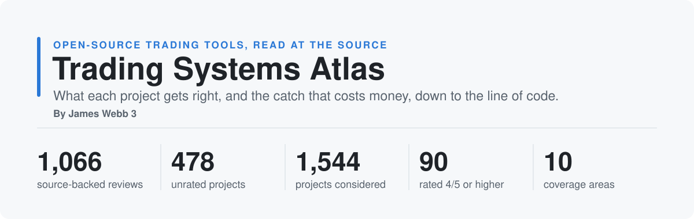
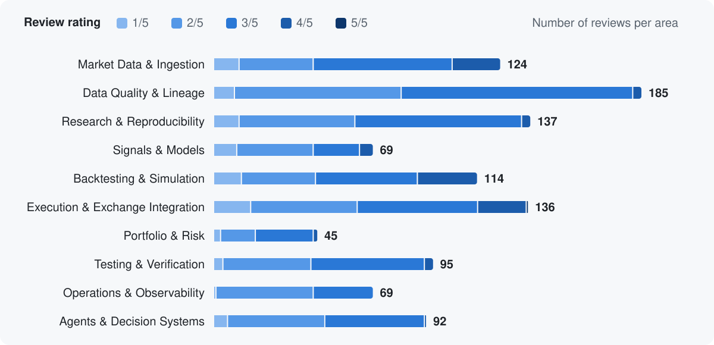

<picture>
  <source media="(prefers-color-scheme: dark)" srcset="assets/hero-dark.svg">
  
</picture>

<strong>By James Webb 3</strong>

  <a href="#start-with-your-problem"><b>Start with your problem</b></a> ·
  <a href="#top-rated"><b>Top-rated</b></a> ·
  <a href="#explore-by-area"><b>Browse by area</b></a> ·
  <a href="PROJECTS.md"><b>All {{PROJECT_COUNT}} projects</b></a> ·
  <a href="METHODOLOGY.md"><b>How we rate</b></a>

**Which open-source trading tools get the hard parts right?** For each rated review, we inspect the source code to see how the project handles lookahead, fills, disconnects, chain reorganizations and the other places where a trading system quietly loses money.

Built for **systematic crypto trading**: perpetual futures, on-chain DEX venues such as Hyperliquid, and on-chain data. Stock, forex and general engineering tools are included when their mechanisms transfer, and are rated for what they offer a crypto trading system.

## Why this Atlas is different

<table>
<tr>
<td valign="top" width="50%"><b>🔍 Source, not stars</b> Every review links to the exact lines of code behind it, at a pinned commit you can open yourself.</td>
<td valign="top" width="50%"><b>⚠️ Every review names the catch</b> Next to the mechanism worth copying, you get the limitation that bites when real money is involved.</td>
</tr>
<tr>
<td valign="top"><b>⚖️ Rated for trading, not popularity</b> An excellent general-purpose library can score 2/5 if it does not touch a trading risk. A 4/5 needs a trading-specific mechanism visible in code.</td>
<td valign="top"><b>🚫 Nothing to sell</b> No sponsored listings, no affiliate links, no backtest screenshots. We do not measure or promise returns.</td>
</tr>
</table>

{{EXAMPLE}}

{{QUESTIONS}}

## Why {{UNRATED_COUNT}} projects are unrated

**A rating is a claim we should be able to defend.** It says that a specific mechanism in the code is useful for a trading-system decision, and it names the condition or limitation that matters. We publish that claim only when we can trace it to relevant implementation at a pinned commit. GitHub stars, a feature list, or a plausible README are not enough.

A project stays in the [search ledger](PROJECTS.md) without a score if it is a reading list or tutorial rather than an inspectable mechanism; its useful pattern is generic or already covered more directly; the available source does not substantiate its interesting claim; or its scope is too far from the trading decisions covered here. This preserves useful leads without implying a completed review or a trading endorsement.

**How far the {{UNRATED_COUNT}} records got:** {{SOURCE_NOTE_COUNT}} had source reading but no complete published assessment; {{DOCUMENTATION_SCREEN_COUNT}} were screened from documentation; {{SCOPE_SCREEN_COUNT}} stopped at an initial fit check; and {{UNRESOLVED_COUNT}} lacked verifiable source or implementation. These are evidence states, not software-quality scores. [See every project and its status](PROJECTS.md) · [Read the publication gate](METHODOLOGY.md#publication-gate).

## The Atlas at a glance

<picture>
  <source media="(prefers-color-scheme: dark)" srcset="assets/areas-dark.svg">
  
</picture>

{{MID_SHARE}}% of reviews land at 2 or 3: a useful pattern with real limits. The last segment of each bar counts its share of the {{TOP_COUNT}} reviews rated 4/5.

{{SHORTLIST}}

{{HIGHLIGHTS}}

{{CATALOG}}

## What the reviews cover

The [complete project ledger](PROJECTS.md) tracks all {{PROJECT_COUNT}} discoveries with their evidence status. Only the {{REVIEW_COUNT}} completed reviews carry a rating.

Each completed review examines a specific mechanism at a pinned commit, with links to the documentation and code behind the assessment. It records the review date, declared license, and limits of the inspected path. Some also examine relevant tests; we do not run upstream software.

**Review ratings describe the usefulness of that inspected mechanism to a trading system.** They do not score every feature of a project. Trading-specific mechanisms and general engineering tools have different scoring criteria, explained in the [methodology](METHODOLOGY.md).

**Not financial advice.** The Atlas reviews software engineering, not strategies. A good rating is not a recommendation to trade, to use a project with real money, or a claim about any project's returns. The reviewed projects are independent and not affiliated with the Atlas.

## Keep the Atlas useful

⭐ Star the Atlas to keep these reviews handy when choosing your trading stack.

Found a project worth reviewing or a claim we should correct? [Suggest a project or correction](CONTRIBUTING.md).

[Review methodology](METHODOLOGY.md) · [Area definitions](CATEGORIES.md) · [All updates](CHANGELOG.md)

Text and data: [CC BY 4.0](https://creativecommons.org/licenses/by/4.0/), with credit to Trading Systems Atlas — James Webb 3. Scripts: MIT. See [LICENSE](LICENSE).
