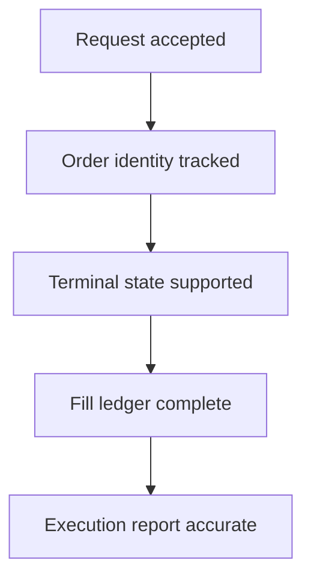

# When is an order actually done?

A successful request, a terminal order status, a complete set of fills, and an accurate execution report are four different facts. Open-source implementations expose different parts of this chain. This guide shows what to inspect before relying on an order lifecycle.

> **Accepted ≠ terminal ≠ fully accounted.**

Each step needs its own evidence. Passing one step does not prove the next.

## The evidence chain

### 1. Was each order accepted?

CCXT's Hyperliquid adapter checks [errors inside per-order statuses](https://github.com/ccxt/ccxt/blob/eb062f442781a7f69335cf50d2916c9f8d79d509/ts/src/hyperliquid.ts#L5055-L5073), even when the outer response reports success. **Check:** record the outcome of each order, not only the HTTP or batch result.

A timeout leaves acceptance unknown. HyperTrade [keeps a deterministic client order ID through a retry](https://github.com/davassi/hypertrade/blob/86ca5db5b2fe1ae1d35ec9e2ad3a83294ace7186/hypertrade/routes/webhooks.py#L45) and [queries Hyperliquid before sending again](https://github.com/davassi/hypertrade/blob/86ca5db5b2fe1ae1d35ec9e2ad3a83294ace7186/hypertrade/routes/webhooks.py#L95); an inconclusive lookup prevents a blind resend. **Check:** preserve intent identity across retries and restarts, and keep the outcome unknown until account-side order and fill evidence resolves it. A stable ID alone cannot prove that a timed-out order was never accepted.

### 2. Can an early fill be matched to an order?

AAT [records a pending action before sending](https://github.com/AsyncAlgoTrading/aat/blob/c4a07d4102a811c779957033aa26a598c1795cdb/aat/engine/dispatch/execution/execution.py#L44-L70) and [matches a trade that arrives before the send returns](https://github.com/AsyncAlgoTrading/aat/blob/c4a07d4102a811c779957033aa26a598c1795cdb/aat/engine/dispatch/execution/execution.py#L114-L140). **Check:** preserve intent and identity before the asynchronous boundary.

A replacement creates another identity question. Titan [ignores a late terminal event for the old exchange order ID](https://github.com/dominolu/titan/blob/fa6a1535f02839fc5a1978aa7bca2f5feee98079/connector/src/hyperliquid/ordermanager.rs#L102-L113) after a new order opens under the same client ID. **Check:** track client intent and each exchange order instance separately.

### 3. Is terminal state supported by complete account evidence?

Kerosene requires [complete fill evidence](https://github.com/nilesjarvis/kerosene/blob/2c193855c7223c3842de068ebe5d23b73252ca31/src/account_update/stream/chase/fill_reconciliation.rs#L15-L31) and an [authoritative open-order view](https://github.com/nilesjarvis/kerosene/blob/2c193855c7223c3842de068ebe5d23b73252ca31/src/account_update/stream/chase/fill_reconciliation.rs#L63-L106) before closing a chased order. **Check:** absence from an incomplete snapshot is unknown, not proof of closure.

A failed account query is also unknown. Quant Flow [skips an order-monitor cycle](https://github.com/web3spreads/quant-flow/blob/3f05254f066f32af0c90b94fbbe6db2e87f3f518/src/trading/order_manager.py#L153-L162) when its open-order query fails, rather than treating failure as an empty list. Its [local timeout removal](https://github.com/web3spreads/quant-flow/blob/3f05254f066f32af0c90b94fbbe6db2e87f3f518/src/trading/order_manager.py#L167-L181) shows why one useful guard does not establish the whole lifecycle.

### 4. Are fills and execution metrics complete?

Hummingbot [deduplicates fills by trade ID](https://github.com/hummingbot/hummingbot/blob/9af100d6822da7d2d0291a906c730ef172284ee2/hummingbot/core/data_type/in_flight_order.py#L351-L369). When a FILLED status arrives before its trade details, the tracker [waits, then proceeds after a timeout](https://github.com/hummingbot/hummingbot/blob/9af100d6822da7d2d0291a906c730ef172284ee2/hummingbot/connector/client_order_tracker.py#L267-L293). **Check:** report fill completeness separately from terminal status.

Kerosene's own [metrics audit](https://github.com/nilesjarvis/kerosene/blob/2c193855c7223c3842de068ebe5d23b73252ca31/docs/advanced-orders/chase-metrics-audit.md#L25-L82) says an archived average price can reflect the last working limit rather than fill-weighted execution. **Check:** calculate execution price and fees from fill records, not the final limit.

### 5. Has the resulting exposure actually settled?

An order can be terminal while a hedge or replacement remains in flight. In a cross-venue example, XEMM [subtracts reserved same-side hedges from uncovered exposure](https://github.com/djienne/XEMM_CROSS_EXCHANGE_MARKET_MAKING_PACIFICA_HYPERLIQUID/blob/2260cc353bc7a7e9c35b448df21d0b6f7a7fc8be/src/services/position_reconciler.rs#L154-L169) and [requires two neutral observations with no maker orders](https://github.com/djienne/XEMM_CROSS_EXCHANGE_MARKET_MAKING_PACIFICA_HYPERLIQUID/blob/2260cc353bc7a7e9c35b448df21d0b6f7a7fc8be/src/services/position_reconciler.rs#L94-L118) before closing a cycle. **Check:** distinguish completed fills, pending hedges and observed position. Its bounded fill-dedup cache still needs durable reconciliation for late duplicates.

## Before you call an order done

- Can ACK, fill, cancel, and replacement events arrive in different orders without losing or duplicating a fill?
- Which snapshots are complete enough to prove an order is absent or closed?
- Are query failure and a confirmed empty result different states?
- Are executed quantity, average price, and fees derived from deduplicated fills?
- Is fill completeness recorded independently of terminal status?
- Could a retry duplicate an order whose first response was ambiguous?
- Is residual exposure computed after pending hedges and still-open maker orders?

## Source reviews

[Kerosene](../reviews/kerosene.md) · [AAT](../reviews/aat.md) · [Titan](../reviews/titan.md) · [Hummingbot](../reviews/hummingbot.md) · [CCXT](../reviews/ccxt.md) · [Quant Flow](../reviews/quant-flow.md) · [HyperTrade](../reviews/davassi-hypertrade.md) · [XEMM Pacifica–Hyperliquid](../reviews/djienne-xemm-cross-exchange-market-making-pacifica-hyperliquid.md)

**Scope:** This guide compares source code at the commits linked above. It is a design aid, not a runtime test, security audit, or claim that any project is ready for live trading.
